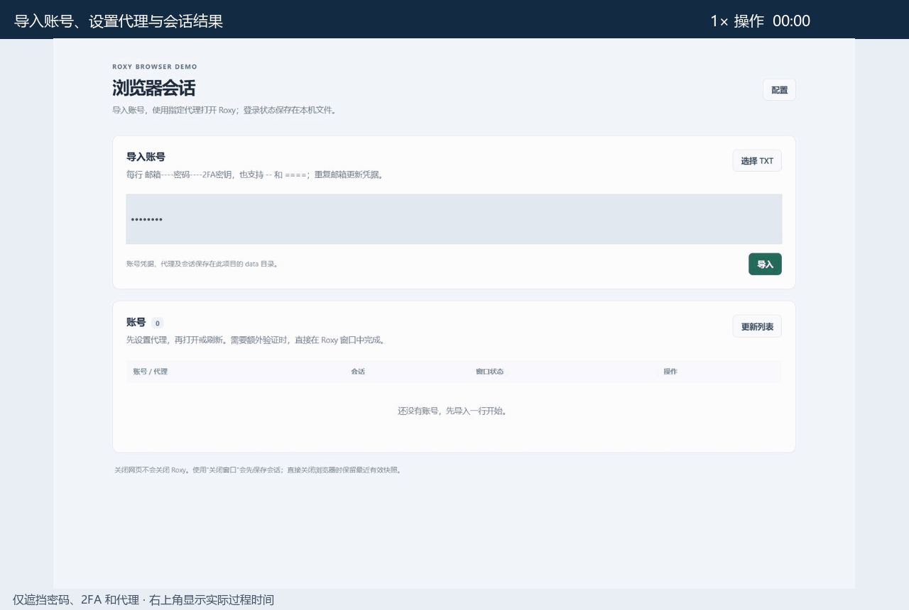

# ChatGPT Roxy Login

通过 Roxy 浏览器自动登录 ChatGPT，支持多账号、独立代理、会话保存与恢复、刷新会话和复制 Token。数据使用本地 JSON 文件保存。

## 使用

需要 Windows、Python 3.10+（含 Tcl/Tk）和已启用本地 API 的 Roxy。

1. 启动 Roxy，双击 `start.bat`，等待依赖安装并自动打开网页。
2. 在网页“配置”填写 Roxy 地址和 API Key，点击“获取团队/项目”，选择后保存。
3. 导入账号，为账号保存代理，然后点击“打开”。

账号格式：每行 `邮箱----密码----2FA密钥`，可粘贴或上传 TXT。额外验证需要在 Roxy 窗口中手动完成。

账号、代理和会话保存在 `data/`。通过网页使用“刷新会话”“关闭窗口”和“复制 Token”。

## 演示

新建 Profile，自动完成密码和 TOTP 登录；实际出现 1 次自动重试。过程耗时约 2 分 24 秒，等待段加速后约 36 秒。

